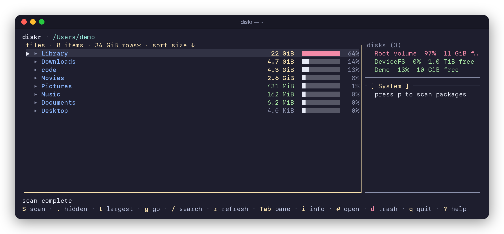

<div align="center">

# diskr

**See where your disk space went, and what you can safely take back.**

A fast, macOS-native disk explorer for the terminal, written in Rust.

[](https://crates.io/crates/diskr)
[](https://github.com/milobeans/diskr/actions/workflows/ci.yml)
[](#compatibility)
[](LICENSE)


**[Website & docs](https://milobeans.github.io/diskr/)** · [Install](#install) · [Tour](#a-quick-tour) · [Keys](#keys) · [Reports](#reports-and-scripting) · [How it works](#how-it-works)

</div>

> **Upcoming release:** This README describes 0.1.84. The latest published
> release is 0.1.83; the new `g` chooser and native installer await 0.1.84
> publication. For currently available installation options and features, see
> the [0.1.83 README](https://github.com/milobeans/diskr/blob/v0.1.83/README.md)
> and [latest release](https://github.com/milobeans/diskr/releases/latest).

## Why diskr

Finder sucks. diskr was built as a simpler and more direct way to manage the files and storage on your mac.

- **What is using the space?** Live directory sizes, sorted by what is really
  allocated on disk. APFS clones, sparse files and compression make apparent
  size misleading, so diskr tracks both and shows the difference.
- **What can I safely delete?** Caches, build output, toolchains and package
  stores are found and labeled *safe*, *regenerable* or *risky*, each with the
  reason why.
- **What changed?** Growth badges keep a stable comparison throughout a
  session, and saved baselines show what grew between two captures.
- **Why doesn't free space add up?** APFS container space, local snapshots and
  user-available versus free blocks, side by side.
- **What are my dev tools costing me?** Homebrew, Cargo, npm, pip and Bun
  packages, plus every project's `node_modules`, `target` and `.venv`, with
  per-item sizes.

It also stays out of your way:

- **Fast and lazy.** Sizing uses `getattrlistbulk(2)` to read many entries per
  syscall, and only scans around what you are looking at. Sizes are cached
  between runs and revalidated with FSEvents. Reliable event history lets
  unchanged trees stay fresh; unavailable or unreliable history triggers
  conservative revalidation.
- **Careful by default.** `--reclaim` only reports; it never deletes. In the
  TUI, destructive keys are red and ask for confirmation. Files move to the
  Trash; installed packages use their owning manager's uninstall command.
  Unreadable or partial measurements are flagged as lower bounds, never
  silently counted as zero.
- **Native.** Reveal in Finder, open with the default app, copy a path or open
  Terminal at any item.
- **Scriptable.** Every report has a `--json` mode with a versioned schema, and
  `--strict` exits with status 2 when a report is incomplete.

## A quick tour

<sub>Screenshots and the demo above come from the real diskr binary running
against a demo home directory.</sub>

### Everything at a glance


The Files pane sorts by allocated size with a share bar for every row. Inline
tags such as `[cache]` and `[build]` mark reclaimable directories as you
browse, and `↑2.7 GiB` shows growth against the session's comparison size.
Press `.` to reveal hidden directories, which is where `.ollama`, `.cargo`,
`.npm` and friends quietly accumulate. The side panels show your volumes and,
with `p`, installed packages or per-project dependency footprints.

### Know what is safe to delete


Tab to the Reclaim pane (or run `diskr --reclaim ~`) to find caches, build
artifacts and package stores. Every finding explains itself:

| Class | Meaning | Examples |
| --- | --- | --- |
| **safe** | Pure cache, regenerated automatically | `~/Library/Caches`, Xcode DerivedData, Homebrew, npm and pip caches |
| **regenerable** | Costs a rebuild or re-download | `node_modules`, `target`, `.venv`, Cargo registry, iOS DeviceSupport |
| **risky** | May hold data you cannot recreate | Trash, Xcode Archives, simulator devices, Docker data, `.next` output |

Build directories are only flagged when their project markers are present
(`target` next to a `Cargo.toml`, `node_modules` next to a `package.json`), so a
folder named `target` alone is never a recommendation. Sizes are allocated
bytes, which is why Docker's sparse disk image shows `1.5 GiB / 64 GiB`.

Review Trash before emptying it: discarded files are not automatically
regenerated, and emptying is permanent. Candidate bytes are not a promise of
freed space; snapshots and shared APFS blocks can retain storage, and moving
files to the Trash does not free their storage until it is emptied.

### Find the biggest files anywhere


Press `t` on any directory to rank the largest files beneath it, however deep
they are. Reveal one in Finder, open it, or move it to the Trash without
leaving the list.

### See what changed

Save a baseline now and compare whenever you like. diskr keeps the latest
baseline per root, and named baselines let you pin comparison points such as
"before cleanup":

```console
$ diskr --save ~
$ diskr --diff ~
Diff for /Users/demo
Baseline captured 3d ago
Total: 44 GiB disk → 50 GiB disk  (+5.1 GiB)
    +2.7 GiB  grew       .ollama
    +1.5 GiB  grew       Downloads
    +960 MiB  grew       code
```

In the TUI, press `B` to save a baseline for the current directory. The `↑` and
`↓` badges and Growth sort compare against each directory's complete cached
size when the session began, or its first complete measurement if no complete
cached size was available. Refreshing or scanning again does not reset that
comparison, and partial measurements do not show a growth delta. Saved history
baselines are separate and change only when you capture one explicitly.

### Explain your free space

`diskr --space` shows why `df`, Finder and your own math disagree: mount-level
totals, APFS container free space, what is actually available to you, and the
local snapshots that can pin deleted data.

```console
$ diskr --space ~
Space report for /Users/demo
Mount: /System/Volumes/Data (apfs, /dev/disk3s5)
Total: 460 GiB
Used: 446 GiB
Free blocks: 14 GiB
Available to user: 14 GiB
APFS container disk3: 460 GiB total / 14 GiB free
Local snapshots: 3
  com.apple.os.update-16E05F2FFE91F1A5…
  …
```

`diskr --thin-snapshots 10G ~` previews snapshot thinning as a dry run; add
`--yes` to request it.

### Packages and project dependencies



Press `p` for the packages pane. The System view lists Homebrew formulae and
casks, npm, pip, Cargo and Bun installs with per-package sizes; the Projects
view finds dependency directories under the current path and how much each
costs. In System view, `u` filters to dependency leaves, and `x` (or `d`)
runs the owning manager's uninstall flow after confirmation. In Projects
view, `d` moves the selected dependency directory to the Trash after confirmation.

A dependency leaf has no known package-manager dependents. You or your scripts
may still use it directly; review the package before uninstalling it.

<details>
<summary>How package sizes and dependency counts are measured</summary>

Package reports distinguish empty inventories from unavailable managers, command
failures, malformed output, and partial results. Package details retain inventory
and dependency-graph warnings. JSON includes every manager's `scan_state` and
each package's dependency evidence; incomplete graphs have unknown leaf status.
Sizes describe known allocation within their stated footprint: directory trees,
app and manager metadata, installed binaries, RECORD-listed files, or installer
metadata. Details and JSON retain unreadable, skipped-mount and missing-file
counts. A `≥` marker denotes a partial measurement; manager totals also report
unknown and limited-scope footprints.

Manager details and JSON identify the executable and package roots used by the
scan. Uninstall uses that retained installation scope. Cargo follows
`CARGO_INSTALL_ROOT`, its user configuration and `CARGO_HOME`; Homebrew, Bun,
npm and pip supply their active locations through their inventory commands.

Project dependency counts are unique declared names across runtime, development,
optional, peer and build groups, not a count of installed transitive packages.
Cargo target tables and Python PEP/Poetry groups are included; Python names are
normalized and merged across requirements and pyproject declarations. Local
requirements includes are read with size and recursion limits; constraint files
do not add direct dependencies. Go `indirect` requirements are excluded.
Manifests are never executed. Dynamic declarations, executable Gemfiles and
read/parse failures show unknown or lower-bound counts with warnings. JSON uses
`dep_count: null` for an incomplete count and retains `known_dep_count`,
`dependency_count_complete` and `dependency_warnings`.

</details>

## Install

diskr runs on macOS 15 or newer, on Apple Silicon and Intel. With Homebrew,
install the maintained formula from this repository:

```sh
brew tap milobeans/diskr https://github.com/milobeans/diskr
brew install milobeans/diskr/diskr
```

Then run `diskr ~/Downloads` for a focused first scan, or `diskr` to start at
your home folder. Homebrew selects the matching native binary and verifies
its checksum; Rust is not required. To update later, run `brew update` followed
by `brew upgrade milobeans/diskr/diskr`.

Without Homebrew, use the checksum-verified native installer below, or install
through Cargo with Rust 1.88 or newer:

```sh
cargo install diskr --locked
```

<details>
<summary>Native installer without Homebrew or Rust</summary>

Download `install-diskr.sh` and `SHA256SUMS` from the same
[GitHub release](https://github.com/milobeans/diskr/releases/latest). You can
also download the current release in a new, empty working directory:

```sh
curl --fail --location --remote-name "https://github.com/milobeans/diskr/releases/latest/download/install-diskr.sh"
curl --fail --location --remote-name "https://github.com/milobeans/diskr/releases/latest/download/SHA256SUMS"
checksum=$(awk '$2 == "install-diskr.sh" { print }' SHA256SUMS)
test -n "$checksum" && printf '%s\n' "$checksum" | shasum -a 256 -c -
```

After verification prints `install-diskr.sh: OK`, run the installer:

```sh
sh install-diskr.sh
```

The release installer selects your architecture, pins downloads to its release,
verifies the archive checksum and executable version, and installs into
`$HOME/.local/bin`. It also installs the license notices and does not change
shell startup files or ask for administrator access. An optional
`--prefix /absolute/path` installs into that directory's `bin`; `--version
X.Y.Z` selects a specific release.

Start it directly:

```sh
"$HOME/.local/bin/diskr" ~/Downloads
```

For a shorter command, add the installation directory to your shell's `PATH`.
With the default prefix, `export PATH="$HOME/.local/bin:$PATH"` enables it in
the current shell; add that line to your shell configuration if you want it
in future sessions. To update, download the new release's installer and
checksums, verify them again, then run that installer.

Native archives are also available directly for Apple Silicon
(`aarch64-apple-darwin`) and Intel (`x86_64-apple-darwin`). Releases include
SHA-256 checksums and dependency license notices. Check each release's notes
and, when provided, `distribution.json` for its signing status. Signed releases
include notarized, stapled DMGs. Version 0.1.83 archives are unsigned and not
notarized; macOS or organization policy may require a different installation
route. These instructions do not bypass quarantine or security policy.

</details>

To build from a local checkout, run `cargo install --path . --locked`.

## Usage

```sh
diskr               # browse your home directory
diskr ~/Downloads   # start somewhere specific
```

Your first minute:

1. Press `.` to include hidden directories, then `S` to request sizes for
   visible directories. Keep an eye on partial or lower-bound measurements.
2. Select a large directory and press `Enter` to explore it, or `t` to see
   its largest files. `Backspace` goes up; `Esc` returns from Top Files.
3. Press `i` for details or `f` to inspect the selection in Finder. Read a
   cleanup finding's explanation before deciding whether to remove it.
4. Press `?` for help or `q` to quit. `Tab` switches panes, and `p` opens
   package inventory when you need it.

Press `g` to go directly to a folder or saved package profile. The chooser
includes Home, Downloads, Documents, Applications, the filesystem root and
previously scanned roots, and shows each profile's origin and scan scope.
Press `/` there to enter an absolute, current-folder-relative or `~/` path.
Profiles imported from another machine remain visible but cannot run until
recreated locally. A local profile keeps its manager choices, project depth
and exclusions when refreshed at its saved root; navigating elsewhere returns
to the default inventory scope.

### Limited access and incomplete scans

`limited access` means macOS denied access to protected locations; `≥` marks
a size that is only a lower bound. The visible results remain useful, but
they are not a complete account of those folders. Press `?` for access help.

If you want to include protected folders, open **System Settings → Privacy &
Security → Full Disk Access** and choose whether to enable the terminal app
hosting diskr, such as Terminal or iTerm. This permission is optional and
applies to other commands launched by that app too. Follow any macOS prompt
to quit and reopen it, then run diskr again; press `r` to refresh an existing
view after access changes. Full Disk Access does not override filesystem
permissions or make disconnected volumes readable.

## Keys

<details>
<summary>Full key reference</summary>

This table mirrors the in-app `?` overlay and `diskr --help`; an exact-key test
fails the build if the documented and runtime bindings drift. Destructive
keys (`d`, `E`, `x`) are highlighted in red in the TUI.

| Key | Action |
| --- | --- |
| ? | Show full keyboard help |
| q | Quit |
| Esc, Ctrl+C | Cancel a focused listing/inventory/reclaim scan, focus Files, close a modal or clear a filter |
| Up/Down, j/k | Move selection, or scroll keyboard help and detail drawers |
| PageUp/PageDown | Move by a page, including in keyboard help and detail drawers |
| Home/End | Jump to first or last item in lists, help, and detail drawers |
| Enter | Open the selected directory, disk, package, or reclaim finding |
| Backspace | Go to parent directory |
| Left/Right, h/l | Switch pane or package view |
| Tab, Shift+Tab | Cycle panes |
| b | Toggle full-width active view and side panels |
| g | Go to a folder or saved package profile |
| / | Search files in the current directory or filter packages; Enter keeps, Esc clears |
| Left/Right, Home/End (input) | Move the caret in rename, mkdir and search; Backspace/Delete erase a grapheme |
| i | Show details for the selected file, package, or disk |
| . | Toggle hidden files in the Files pane |
| o | Cycle sort mode in the Files pane |
| r | Refresh the current view and rescan all visible directory sizes |
| S | Scan every missing, stale, or incomplete visible directory size in the Files pane |
| B | Save a history baseline for the current Files directory |
| t | Toggle the full-width Top Files browser for the selection; Esc also returns |
| c | Rename the selected file |
| n | Create a directory |
| v | Toggle a mark on the selected file |
| a | Mark all visible files |
| d | Trash file/project dependency (or marks); uninstall installed package |
| f | Reveal selected item in Finder |
| O | Open selected item with the default app |
| y | Copy selected item path to clipboard |
| s | Open selected item location in Terminal |
| p | Open packages; press again while focused to switch package view |
| u | Toggle the dependency-leaf filter in the packages pane |
| x | Uninstall the selected package |
| R | Re-scan the Reclaim pane |
| E | Empty Trash from the Reclaim pane, when the report lists a Trash finding |
| s (disk details) | Retry local snapshot discovery without rerunning APFS discovery |
| a (disk details) | Retry APFS container discovery without rerunning snapshot discovery |
| Up/Down, j/k (details) | Scroll the detail body while actions remain visible |
| PageUp/PageDown (details) | Scroll detail body by ten lines |
| Home/End (details) | Jump to the start or end of detail content |

</details>

## Reports and scripting

The main scan reports also support `--json`. Choose the command for the
question you want to answer:

| Purpose | Command |
| --- | --- |
| Largest files by allocated size | `diskr --top 20 ~/Downloads` |
| Cleanup candidates and their classification | `diskr --reclaim ~` |
| Capture a scan baseline | `diskr --save ~/Downloads` |
| Changes since the saved baseline | `diskr --diff ~/Downloads` |
| APFS free-space breakdown and snapshots | `diskr --space ~` |
| System packages and project dependencies | `diskr --packages ~` |
| Projects only, with bounded discovery | `diskr --packages --projects-only --max-depth 3 --exclude archive ~/code` |
| Selected package managers, without projects | `diskr --packages --manager cargo --manager brew --no-projects ~` |

These scan commands do not delete files or uninstall packages. `--save` writes
a baseline; the other commands report without changing the baseline.

<details>
<summary>Preview and request snapshot thinning</summary>

Preview the request without deleting snapshots:

```sh
diskr --thin-snapshots 10G ~
```

Only if you intend to remove local Time Machine snapshots, run the apply
command separately. It requests up to the stated space from macOS; the amount
actually freed depends on the available snapshots and system permissions.
This removes local restore points and does not move them to the Trash.

```sh
diskr --thin-snapshots 10G --yes ~
```

</details>

<details>
<summary>JSON output, exit codes and filters</summary>

JSON reports use `schema_version: 1` and include a common `report`, `root`,
`root_identity`, `scope`, `coverage`, `warnings`, `timing` and
`numeric_semantics` contract while retaining earlier report-specific fields.
`coverage.complete` is false for unreadable/skipped data, utility failures,
unknown dependency counts, or incomplete/limited package footprints. Explicit
discovery depth and policy exclusions remain visible in scope metadata.
Byte counts are unsigned 64-bit JSON integers; use an integer-capable parser
when values may exceed JavaScript's safe-number range. Signed byte deltas are
decimal strings, timestamps are Unix seconds, and elapsed time is monotonic
milliseconds. `root_identity` is a reversible Unix path encoding; `root` is
the human-readable path.

Default report exit status remains 0 for usable partial reports and 1 for
errors. `--strict` prints the report, then exits 2 if incomplete, with its
diagnostic on stderr. It does not undo a requested `--save`. JSON stdout stays
parseable and contains no progress or error prose; closed output pipes still
finish normally.

`--min-size SIZE` filters allocated-size rows in `--top`, `--reclaim` and
`--packages`; `--class safe|regenerable|risky` filters reclaim categories.
Unknown, partial or limited-scope sizes are retained. Filters affect rows, not
scan totals or completeness; JSON includes filter settings and counts of removed rows.

Space discovery uses the owning volume mount point. APFS failures remain visible
in text and details; JSON retains the error text and an `apfs_diagnostic` object
whose `kind` is `timeout`, `tool_failure` or `malformed_output`.

Follow-up commands printed by reports quote paths for macOS `zsh`; paths
containing control or non-UTF-8 bytes use `$'\\xNN'` byte escapes.

</details>

<details>
<summary>Package scope controls</summary>

Package scope controls apply to `--packages` or `--save-profile`. `--projects-only` never
invokes package managers; `--manager` is repeatable and selects `brew`,
`brew-cask`, `npm`, `pip`, `cargo` or `bun`, with projects still included unless
`--no-projects` is set. `--max-depth` accepts 0 (the selected directory only)
through 64, default 5. Repeat `--exclude` for exact root-relative project
subtrees, not shell globs; absolute paths and `..` are rejected. Exclusions
affect discovery, not the footprint of an included project's dependency tree.
The selected scope is included in JSON and human output.

</details>

<details>
<summary>Named baselines and saved inventory profiles</summary>

The default `--save`/`--diff` pair keeps one latest baseline per root, retaining
up to 512 roots. Named captures are separate, immutable and never silently
replace that latest baseline. Names use 1-80 ASCII letters, digits, `.`, `_` or
`-`. Capture a new name for each comparison point:

```sh
diskr --save --baseline before-cleanup ~/code
```

Compare against that capture later:

```sh
diskr --diff --baseline before-cleanup --json
```

Other library commands are alternatives, not a script to run in sequence:

| Purpose | Command |
| --- | --- |
| List captures and profiles | `diskr --baselines list --json` |
| Protect a capture from pruning | `diskr --baselines pin before-cleanup` |
| Allow a capture to be pruned again | `diskr --baselines unpin before-cleanup` |
| Export the library to a new file | `diskr --baselines export /tmp/diskr-baselines.json` |
| Merge an exported library | `diskr --baselines import /tmp/diskr-baselines.json` |

Preview pruning first. This keeps the ten newest unpinned captures and every
pinned capture:

```sh
diskr --baselines prune 10
```

Apply that pruning decision separately; the command writes a recovery backup
and prints its path before removing captures:

```sh
diskr --baselines prune 10 --yes
```

Save an inventory profile without running a scan:

```sh
diskr --save-profile work --projects-only --max-depth 3 --exclude archive ~/code
```

Run its saved scope when needed:

```sh
diskr --packages --profile work --json
```

In the TUI, press `g` and select the profile to apply the same saved root and
scope. The Packages view identifies the active profile and scope.

Preview removal of an obsolete profile with
`diskr --baselines remove-profile work`. Add `--yes` only when you intend to
back up the library and remove that profile.

Without a path, a named diff uses its stored root. An explicit different root
is rejected, not retargeted. Baselines are stored under
`~/Library/Application Support/diskr/`, and diffs do not overwrite them. The library lives alongside history as
`baseline-library.json`, with a 16MiB bound, at most 2,048 named captures and
256 profiles. Retention/capacity and source identities are visible in the list.
Pruning requires `--yes`, retains all pinned records and writes a backup before
removal. Exports refuse to overwrite an existing file; imports validate before
atomically merging, reject conflicting names, preserve machine/raw-root
identity, and never replace latest-root history. Re-importing identical records
is harmless. A named cross-machine comparison is explicitly warned and partial
for `--strict`; imported foreign profiles cannot run until recreated locally
with an explicit root/scope and a new name.

Profiles save a package inventory root and scope without invoking managers.
`--packages --profile NAME` accepts report filters/JSON/strict options, but not
another path or scope overrides. Saving an existing name is an error.
Obsolete profiles can be removed explicitly with `--baselines remove-profile`;
like pruning, it previews by default and requires `--yes`, with a backup.

</details>

## Appearance and accessibility

| Variable | Effect |
| --- | --- |
| `DISKR_THEME` | `dark` (default), `light`, `high-contrast` or `mono` |
| `NO_COLOR` | Any non-empty value selects monochrome, keeping selection gutters and textual warning/coverage markers |
| `DISKR_REDUCED_MOTION=1` | Replaces animated scan glyphs with a static `scan` label |
| `DISKR_ASCII=1` | ASCII alternatives for common TUI decorations; also disables animation. Unicode filenames remain Unicode |

These preferences affect terminal rendering, not filesystem names, action
targets or JSON data.

## How it works

The core scanner calls `getattrlistbulk(2)` with a packed attribute list
requesting name, object type, logical size, and allocated size. The kernel
fills a buffer with dozens of entries per call, and diskr parses the packed
binary layout directly without allocating per entry on the hot path. A custom
work-stealing thread pool (no rayon) fans out across subdirectories. Scans
start in small batches around the current selection, so opening `/` does not
immediately walk every subtree. Performance depends on the filesystem, tree
shape and cache state; no fixed speedup is promised.

The size cache and history baselines are persisted as JSON through
`serde_json`. On relaunch, diskr replays macOS FSEvents since the previous
session. Reliable event history preserves unchanged cached sizes; unavailable
or unreliable history conservatively marks cached sizes stale for revalidation.

<details>
<summary>Responsiveness, accuracy and cleanup detection</summary>

Startup renders before state loading, with q/Esc/Ctrl+C cancellation. Directory
enumeration runs off the UI loop in bounded batches; navigation and refresh
invalidate older generations. Esc/Ctrl+C in Files cancels enumeration and
labels the shown list partial; `r` retries. Ready inventory rows appear while
other managers/projects are still running. The inventory footer reports elapsed
time and ready stages; Esc/Ctrl+C cancels its read-only subprocesses/walks,
retaining ready rows with a partial marker. Quit cancels read-only discovery,
while pending mutations keep the existing graceful-shutdown policy.

Independent scans of the same root, identity, policy, freshness and requested
Top Files capacity share in-flight work. Each subscriber retains its own
cancellation; one cancelled caller cannot cancel another. Completed broker
results are not retained as a cache, and refresh/mutation invalidates matching
in-flight registrations. History's shared hardlink-accounting scopes remain
separate. Interactive queued roots can be promoted without increasing worker
count; descendants retain the pool's locality-aware traversal.

Sizes count regular-file content only -- symlink targets and directories' own
metadata blocks are not added, so totals run slightly under `du`/Finder, and
directories or entries that cannot be read are flagged as lower bounds rather
than counted as zero. Human terminal output escapes control characters from
filenames and external tools; JSON retains normal structured escaping.

The reclaimable-space detector runs two passes: a fixed-location pass that
checks well-known paths (`~/Library/Caches`, Xcode DerivedData, Homebrew,
Docker, etc.) and a bounded recursive pass that finds repeated build-artifact
directories (`node_modules`, `target`, `.venv`, `__pycache__`, `.next`,
`.gradle`). Both use the same fast bulk scanner for sizing. Esc/Ctrl+C cancels
a focused reclaim scan; quit also cancels its read-only work. Cancelled
findings are not published as a complete report.

Artifact classifications require supporting project/environment markers; a name
such as `target` alone is not a cleanup recommendation. Simulator devices and
deployment output can contain state you cannot recreate. Reports disclose their
depth, mount and hidden/cache exclusions. Candidate allocated bytes are not a
promise of freed space: APFS clones, snapshots and links can retain blocks, and
moving files to Trash does not free their storage until Trash is emptied.
Baseline and cleanup totals deduplicate hardlinks within their selected scope;
independently measured Files rows may share an inode and must not be summed as
an exact unique-root total. Use Top Files for a root-unique content scan.

APFS space reporting combines `statfs(2)` for mount-level stats, a narrow
parser for `diskutil info -plist` output to get container-level free space, and
`tmutil listlocalsnapshots` for snapshot discovery.

diskr uses `ratatui`, `crossterm`, `libc`, `anyhow`, `serde_json`, `toml`, and
the Unicode segmentation/width crates.

</details>

## Compatibility

diskr is macOS-only, on Apple Silicon and Intel; the minimum supported Rust
version is 1.88.0. CI's maintained runtime floor is macOS 15, with native tests
on macOS 15 and 26 for both architectures. Older macOS source builds are
unverified, not deliberately blocked. The macOS-only target guard reports a
clear error on Linux, Windows and unsupported CPU targets.

<details>
<summary>Filesystems and terminals</summary>

The filesystem baseline is local APFS. Hardlinks, sparse files, inaccessible
entries, filesystem identity and tool-output variations have fixture coverage;
other filesystems/network volumes are best-effort and mount exclusions remain
visible. Snapshot/APFS utilities use the owning mount and preserve failures.
Container allocation is not exclusive per-file ownership or a freed-space
guarantee.

Use a UTF-8, VT-compatible terminal; 80×24 or larger is recommended. Headless
frame tests cover 40/80/120 columns and short/tall viewports; native PTY smoke
tests exercise keyboard input and clean shutdown. ASCII decoration preferences
do not transliterate Unicode filenames. No promise of identical glyph widths
across every terminal/font or multiplexor is made.

</details>

## Development

Planned work lives in [ROADMAP.md](ROADMAP.md), and release history lives in
[CHANGELOG.md](CHANGELOG.md).

<details>
<summary>Checks, benchmarks and releases</summary>

### Release checks

```sh
cargo fmt -- --check
cargo check --locked
cargo clippy --locked --all-targets --all-features -- -D warnings
cargo test --locked
cargo package --locked
cargo audit
```

### Benchmarks

Run the complete optimized protocol and retain its results with:

```sh
python3 scripts/benchmarks.py --output target/benchmark-results
```

The runner executes the five benchmark fixtures serially, then samples native
TUI idle behavior for five seconds (`--idle-seconds` accepts 1–60). It writes
`metadata.json`, `results.json`, `benchmarks.log`, `native-tui.log` and a
readable `summary.md` beneath the selected output directory. Metadata includes
the revision and dirty-tree flag, macOS/build, architecture, CPU, memory,
toolchain, filesystem and measurement protocol.

The **Benchmarks** GitHub Actions workflow runs weekly on Apple Silicon and
Intel and can also be started manually. Download its `benchmark-results-…`
artifacts within 90 days to compare runs with matching machine and fixture
conditions. Timing trends are informational; failed deterministic assertions
or missing expected measurements still fail the run.

Repeatable optimized performance checks (temporary fixtures only):

```sh
cargo test --release --locked benchmark_shared_scan_and_heap_paths -- --ignored --nocapture
cargo test --release --locked benchmark_package_viewport_frames -- --ignored --nocapture
```

The scan check creates 10,000 small files, warms the fixture, and reports
median/p95 wall time over 12 samples for direct versus brokered scans, four
independent versus shared requests, and eager versus size-gated Top Files path
construction. Its p95 is the largest sample (nearest-rank percentile). It is a
warm-cache local comparison, not a cold-disk or universal throughput claim.
The viewport check uses isolated fixtures, 100 and 10,000 packages, 120×40
frames, and 100,000 synthetic file rows. It reports frame p50/p95, thread-local
allocation events (alloc/realloc), and cold/cached aggregate time. These are
rendering measurements, not filesystem throughput claims. Neither benchmark
enforces machine-dependent timing thresholds.

For the full fixture protocol, run benchmarks serially so scanner counters and
timings do not include another benchmark's work:

```sh
cargo test --release --locked benchmark_ -- --ignored --nocapture --test-threads=1
DISKR_BENCH_IDLE_SECONDS=5 cargo test --release --locked --test cli native_tui_restores -- --nocapture
```

Fixtures cover a flat 10,000-file listing, 10,000 files across 100 directories,
a 64-level chain, denied directories, hardlinks, a 1GiB sparse file, and an APFS
clone where supported. Normal tests also exercise an injected foreign device
and real read-only APFS helper-mount rejection before enumeration; no mount or
privileged tracing setup is performed. Listing checks report first-row and total
latency, p95 cursor/batch-drain time and harness RSS. Boundary scans report
direct scanner `openat`/`fstat`/`getattrlistbulk`/`close` counts from test-only
instrumentation, not system-wide or std-library syscall totals. The native
100×24 PTY check loads 10,002 files and measures first paint/row, idle CPU time
with Mach timebase conversion, and child-process RSS. Idle sampling is opt-in
(1-60 seconds), not a CI speed threshold. It also exercises retained filtering,
refresh, confirmation cancellation, help, quit and terminal restoration using
an isolated HOME; destructive confirmation is never accepted.

Record CPU, macOS/filesystem, terminal dimensions, build profile, warm/cold cache
state, sample count and tool versions when comparing results. These fixtures
are local warm-cache diagnostics, not a claim about every volume or workload.

### README images and website

The screenshots, demo animations and social preview in `.github/assets/`, and
the replay data behind the [website](https://milobeans.github.io/diskr/)
(`site/assets/replay.json`), are generated from the release binary, not drawn
by hand. After a UI change, regenerate them with:

```sh
python3 scripts/screenshots/generate.py
```

It needs macOS, `img2webp` (`brew install webp`) and about 4 GiB of free
space. It builds a synthetic home directory and Homebrew Cellar from APFS
clones on a throwaway disk image, drives diskr in a pseudo-terminal, and
installs its pinned Python packages into `target/screenshots/venv`. The demo's
Trash moves stay on that image and its `brew` is a stand-in, so nothing outside
the image is deleted. Host paths are masked as `/Users/demo`; the disks panel
still shows the machine's real volumes.

The website in `site/` is static HTML, CSS and JavaScript with no build step;
preview it with `python3 -m http.server -d site` after copying
`.github/assets/*` into `site/assets/img/`. Validate it locally with:

```sh
npm ci --prefix scripts/site-validation
npm --prefix scripts/site-validation run check
npm --prefix scripts/site-validation exec -- playwright install --with-deps chromium
npm --prefix scripts/site-validation run test:browser
```

The checks assemble a preview under `target/site-validation`, validate links
and assets, and exercise copy payloads, search keyboard behavior, replay
loading, color contrast and narrow layouts. The Pages workflow runs these
checks before publishing site or image changes from `main`. A Rust test also
keeps the site's key reference in sync with the keymap.

### Releases

Releases are automated through GitHub Actions and appear in the GitHub Releases tab.

One-time setup:

1. Add a repository secret named `CARGO_REGISTRY_TOKEN` with a crates.io API token that has publish access for `diskr`.

Developer ID signing and notarization are optional and disabled until the
required credentials are provisioned. Apple Developer Program membership or
an Apple Development certificate alone does not configure distribution
signing. To enable it, set the repository variable `MACOS_SIGNING_ENABLED`
to `true` and configure these repository secrets:

| Secret | Value |
| --- | --- |
| `MACOS_DEVELOPER_ID_P12` | Base64-encoded Developer ID Application certificate and private key exported as a P12 |
| `MACOS_DEVELOPER_ID_PASSWORD` | Password protecting that P12 |
| `MACOS_DEVELOPER_ID_IDENTITY` | Full `Developer ID Application: …` identity |
| `APPLE_NOTARY_KEY_P8` | Base64-encoded App Store Connect team API private key with notarization access |
| `APPLE_NOTARY_KEY_ID` | API key ID |
| `APPLE_NOTARY_ISSUER_ID` | Team API issuer ID |

When enabled, the workflow signs the executable and produces notarized,
stapled DMGs alongside the archives containing the signed executable. It
requires valid credentials and successful notarization; enabling the setting
does not itself establish that a release is signed. Keep credentials in
GitHub Secrets and never in the repository.

Release flow:

1. Move the `[Unreleased]` section of `CHANGELOG.md` into a new version
   section dated today (leave `[Unreleased]` present and empty).
2. Update `Cargo.toml` to the new crate version.
3. Refresh `Cargo.lock` if needed and push the version bump to `main`.
4. Create and push a matching tag like `v0.1.14`.

```sh
git tag -a v0.1.14 -m "v0.1.14"
git push origin v0.1.14
```

When that tag is pushed, the `Release` workflow will:

1. Verify the tag matches the crate version.
2. Verify the tagged commit is reachable from `main`.
3. Run the full release validation set.
4. Publish the crate to crates.io if that version is not already published.
5. Download the published crate and verify it was built from the exact tag commit.
6. Create the matching GitHub release once, using the released changelog
   section for its notes.

After the workflow succeeds, verify the release's `diskr.rb` against its
`SHA256SUMS` entry, replace `Formula/diskr.rb` with that verified asset, and
push the formula update to `main`. This tooling-only update needs no version
bump or release tag. Keep the tap on the latest successfully published release,
so Homebrew never points at assets that are still being built.

Release notes and `distribution.json` record whether that release was Developer
ID signed and Apple notarized. Check those records for the release you install;
the repository's optional signing configuration is not evidence about an
earlier artifact.

</details>

## License

[MIT](LICENSE)
